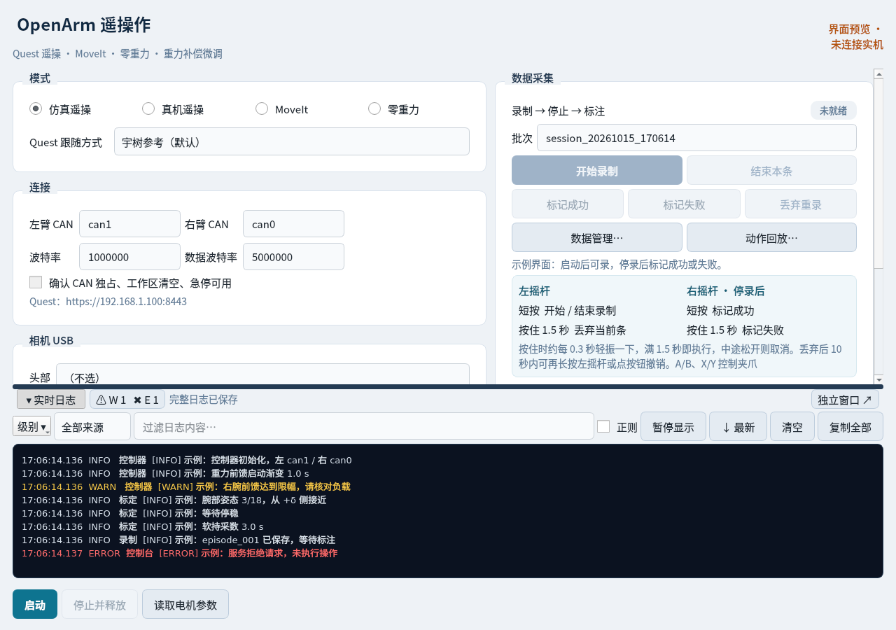
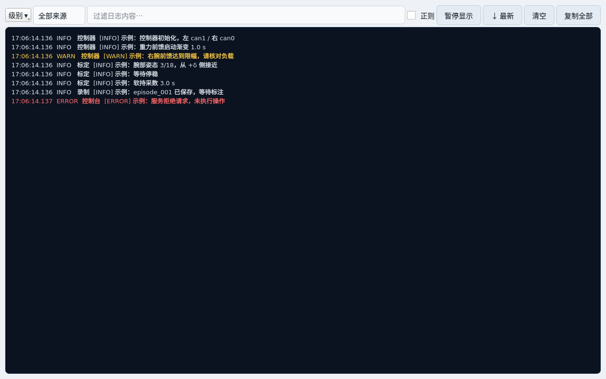

# 实时日志使用说明

实时日志按 2026-10-15 的《实时日志显示方式与窗口尺寸调研》调整为底部工具面板。以下截图使用示例消息，未连接实机。

## 打开方式和尺寸

- 首次打开控制台时日志收成底部一条。点击“实时日志”标题或按 **Ctrl+J** 折叠、展开；折叠后保留标题、错误计数和独立窗口入口。严重错误会自动展开。
- 展开后拖动日志顶部的横条调整高度。记住的高度默认约 260 px；展开最小 120 px，上限为窗口高度的 60%。
- 点击 **独立窗口** 打开大日志窗口。关闭窗口或点击“收回面板”会回到主界面，同一份日志继续显示。
- 主窗口默认目标尺寸扩大为 1280×900，同样受屏幕尺寸限制。面板高度、折叠状态和独立窗口尺寸会保存，下次启动恢复。

## 回看和暂停

只有停在底部时才跟随新日志。向上滚动后，阅读位置保留；“↓ 新日志 N 条”显示尚未跟随的消息数，点击回到底部。

“暂停显示”只暂停刷新，后台仍接收日志并保存到文件；点击“继续显示”恢复。日志面板和独立窗口中的暂停、过滤状态共用。

## 配色、过滤和查找

每条日志显示本地接收时间（精确到毫秒）、级别、来源和正文。正文保留原始消息中的时间与标签。

| 级别 | 显示方式 |
| --- | --- |
| DEBUG | 灰色，默认不显示，可在“级别”菜单勾选 |
| INFO | 浅色 |
| WARN / WARNING | 黄色 |
| ERROR | 红色 |
| FATAL | 白色粗体、红底，另有非阻塞提示条和状态提示 |

- “级别”支持多选；“来源”可选择控制器、标定、录制、控制台。录制来源通过已知输出标签推断，没有这些标签的控制器消息仍归控制器。
- 过滤框默认按正文子串匹配、不区分大小写；勾选“正则”后使用正则匹配，无效表达式会显示提示。
- **Ctrl+F** 打开查找栏，高亮可见日志中的匹配文本；Enter 跳到下一处。查找不会修改过滤条件。
- 点击 `W / E` 计数跳到下一条错误。错误被过滤隐藏时会恢复错误级别及全部来源，并清除文本过滤。计数是自上次清空以来的累计值，包含被过滤的消息；已淘汰出缓冲的错误应到文件查看。

## 清空、复制和完整文件

“清空”清除显示缓冲和计数，不删除文件。“复制全部”复制当前缓存中的日志，包括被过滤的消息和暂停期间的待显示消息。

显示缓冲最多 5000 行，待处理队列也有上限。每 100 ms 批量刷新；突发输出每批显示最近 500 条，并用提示说明省略行数。**文件仍保留收到的完整消息，暂停或显示节流不会删除文件内容。**

每次打开控制台会生成独立归档：系统临时目录下的 `openarm_console_日期_时间_进程号.log`。标题中的“完整日志已保存”悬停提示给出实际路径，文件使用带时区的 ISO 时间。系统清理临时目录时可能删除这些文件，需要长期留存时请另行复制。

控制器原始日志仍在 `openarm_vr_teleop_app.log`；面板对它增量读取，不再每次读取全文或只保留最后 80 行。标定输出与控制器输出统一追加，互不覆盖。

修改后需重新打开控制台才能加载新界面。关闭独立日志窗口、暂停显示和清空面板都不停止机械臂控制进程。
