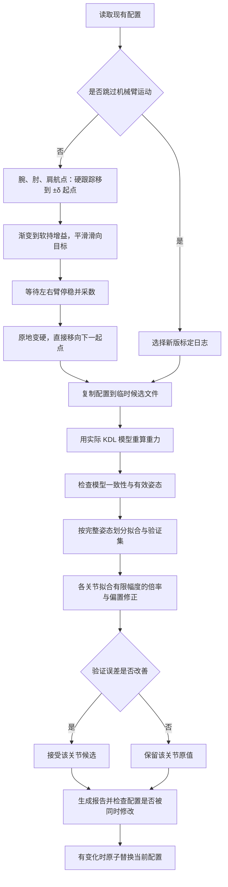

# 自动重力标定流程说明

当前界面入口为“使用 URDF 初值”“自动微调”和“惯量标定”，都以当前 `gravity_comp.yaml` 为起点；手动微调窗口已移除，个别参数需要修改时直接编辑 YAML。各步骤写入时直接覆盖当前配置，不再另存备份；需要保留某一版参数时，请自行复制 `gravity_comp.yaml`。

| 阶段 | 是否动臂 | 作用 | 写入内容 |
| --- | --- | --- | --- |
| ① 使用 URDF 初值 | 否 | 新臂或重新开始时，把模型修正恢复为 URDF 基准 | 质量/质心、关节倍率/偏置归一，前馈增益 0.95；保留夹爪/相机安装状态、负载和摩擦 |
| ② 自动微调 | 是，约 10–15 分钟 | 各姿态 ±δ 两侧软持采数，再小幅精修关节倍率/偏置 | 仅关节倍率/偏置，留出姿态验证改善才写 |
| ③ 惯量标定 | 否 | 用②的两侧日志辨识各连杆质量/质心 | 左右各自质量倍率与质心偏移，远端增益、倍率、偏置归一；先预览再确认 |

新臂推荐顺序：① → ② → ③ → 零重力验证 → 再次 ② 精修。夹爪或相机拆装后，先改 YAML 中的 `*_gripper_present` / `*_wrist_camera_present`，再从 ① 开始。

> 本文依据当前仓库实现编写，说明默认自动标定的实际行为。默认入口为 `scripts/calibrate_gravity.py`，界面入口为“自动微调”。

## 1. 当前自动标定解决什么问题

当前默认方案是在一套已有、基本能用的零重力配置上，自动修正各关节的重力倍率与偏置。

它不再默认清空手调参数，也不再默认重新辨识所有连杆的质量、质心和摩擦。这样可以避免多个参数互相补偿、离线拟合很好而真机手感变差的问题。

默认可能更新的字段只有以下四组，每组包含 j1～j7：

| 配置字段 | 含义 |
| --- | --- |
| `left_gravity_scale` | 左臂各关节重力倍率 |
| `right_gravity_scale` | 右臂各关节重力倍率 |
| `left_gravity_bias` | 左臂各关节重力偏置，单位 Nm |
| `right_gravity_bias` | 右臂各关节重力偏置，单位 Nm |

默认保留以下参数：连杆质量倍率、质心修正、URDF 重力倍率、额外负载、夹爪电机质量、相机质量与位置、远端增益、关节及夹爪摩擦、腕部阻尼、零重力前馈增益和 MoveIt 跟踪增益。

`--g-scale` 是显式例外：指定后会在候选配置中更新 `g_scale` 与 `ff_gain`。日常标定建议不指定，以保持与已有手感一致。默认流程拒绝通过 `--ee-payload` 或 `--urdf-scale` 临时更改物理模型；应先修改 YAML，再重新采数。

## 2. 总体流程



任一关键阶段失败时，默认编排不会将候选写回当前配置；采数日志仍会保留。

## 3. 启动与准备

### 3.1 界面启动

运行 `./app.sh`，停止正在运行的遥操作、零重力或 MoveIt 模式，选择“零重力”模式并勾选安全确认，再点击“自动微调”。界面会检查：

- 当前模式已停止，未有同类标定进程正在执行。
- 已勾选安全确认。
- 左右 CAN 名称非空且不同。
- 波特率为整数。

确认后，界面配置 CAN，并启动：

```bash
scripts/calibrate_gravity.py --trajectory waypoints --write <当前重力配置>
```

默认左臂为 `can1`，右臂为 `can0`。命令行入口不提供与界面完全相同的安全确认和 CAN 配置流程，需预先完成设备设置并确保 CAN 被独占。

### 3.2 推荐命令

以下命令从仓库根目录执行。第一条会驱动真机：

```bash
# 重新采数、拟合、验证，并在候选通过时写回
.venv/bin/python scripts/calibrate_gravity.py

# 仅使用新版日志做离线预览：不运动、不写配置
.venv/bin/python scripts/calibrate_gravity.py --skip-motion --dry-run

# 仅使用新版日志拟合，通过后允许写回：不运动
.venv/bin/python scripts/calibrate_gravity.py --skip-motion
```

**`--dry-run` 单独使用仍会运动和采数，只是不写配置。要完全离线，必须同时指定 `--skip-motion`。**

## 4. 候选隔离（不另存备份）

默认读取 `config/gravity_comp.yaml`（界面会跟随 `OPENARM_GRAVITY_YAML`）。标定不创建备份文件，成功时直接原子替换当前配置。

采数使用原有配置；拟合使用系统临时目录中的配置副本。原文件不会在拟合过程中被反复覆盖。最终写回前还会比较原文件内容：如果其他界面或进程在标定期间修改了配置，本次候选会被拒绝覆盖。

这项保护是内容比较，不是跨进程文件锁；标定期间仍应避免同时调整参数。

## 5. 航点运动与软持采数

### 5.1 当前使用的轨迹

当前默认使用原有分阶段航点，按腕→肘→肩执行。左右臂按关节镜像关系运动：j1、j2、j5、j6、j7 反号，j3、j4 同号。

| 阶段 | 日志轨迹号 | 当前规划姿态数 |
| --- | --- | ---: |
| 腕部 | 100～199 | 9 |
| 肘部 | 200～299 | 6 |
| 肩部 | 300～399 | 13 |

肩部阶段末尾的 340～344 是手臂贴身（j2 = −0.15）、肘部近伸直（j4 = 0.20）、j1 前抬 80°→60°→40°→20°→0° 的姿态。其余航点的 j2 都外展 40°～90°，在贴身前抬时 j1 的补偿只能外推：曾出现抬高后下坠、改质心后低于 40° 自行上抬的情况。80° 前抬时手臂近水平前伸，运行前确认前方约 0.7 m 无障碍。

当前代码没有继续默认使用连续傅里叶激励。`--trajectory fourier` 保留为兼容选项，会退回航点方案，不能将其理解为已实现动态惯量辨识。

### 5.2 每个姿态如何执行

默认（`OPENARM_CALIB_APPROACH=both`）每个姿态软持两次，分别从两侧接近：

1. 用较高 PD 增益移动到目标姿态，移动时不采数。采用三次平滑插值，指令速度峰值不超过 `0.10 rad/s`，并发送相应速度前馈。到位后硬保持约 `0.7 s`。
2. 硬跟踪移到偏置姿态“目标 + δ”，δ 为 j1–j7 `[0.15, 0.15, 0.12, 0.12, 0.12, 0.10, 0.12] rad`，并夹在 URDF 限位内留 `0.05 rad` 余量；右臂取镜像。硬保持约 `0.7 s`。
3. 用约 `0.8 s` 将增益渐变到低刚度软持，此时软持目标仍在偏置姿态。
4. 在 `1.5 s` 内把软持目标平滑移回原目标，不发送速度前馈。关节在软弹簧带动下从同一侧靠近并停下。
5. 等待左右臂同时满足停稳判定，停稳后记录约 `3 s`，日志 `approach=+1`。
6. 渐变回硬跟踪，回到原目标。再以“目标 − δ”重复第 2～5 步，日志 `approach=-1`。

静摩擦总是阻碍最后一段运动。两侧接近时摩擦方向相反，所以拟合取两次软持目标的平均作为重力，取两次差值的一半作为静摩擦估计。单侧软持时，若重力残差小于静摩擦，关节根本不会下垂，原流程测到的残差为零，无法发现补偿不足。

`OPENARM_CALIB_APPROACH=single` 保留原流程：到位后直接渐变到软持，普通航点采数约 `5 s`，起始姿态约 `2 s`，日志 `approach=0`。按上述时长估算，两侧流程每个姿态多约 12 s，全程多约 5 分钟（未在真机计时）。

停稳使用关节位置差分得到的最大速度，要求低于 `0.05 rad/s` 并持续约 `0.40 s`。等待超过 `3 s` 仍不满足时，跳过该次软持，不用未停稳数据强行拟合。两侧日志中只有一侧停稳的姿态在拟合时被剔除，并在输出中提示数量。

偏置量的前提是软持弹簧 `Kp × δ` 大于静摩擦，关节才会被拉动；j4 的 `0.24 Nm` 可能小于其静摩擦。拉不动时，两次软持停在对称位置，平均值不提供新信息，该关节保留原值，不会被拟偏。

控制循环目标周期为 `10 ms`，日志在满足条件时每两轮记录一次，每臂约 `50 Hz`。这是目标频率，实际频率取决于 CAN、调度和执行耗时。

### 5.3 软持增益

| 增益 | j1 | j2 | j3 | j4 | j5 | j6 | j7 |
| --- | ---: | ---: | ---: | ---: | ---: | ---: | ---: |
| Kp | 2.5 | 2.5 | 2.0 | 2.0 | 1.0 | 1.0 | 1.0 |
| Kd | 0.35 | 0.35 | 0.30 | 0.30 | 0.15 | 0.12 | 0.15 |

软持允许适量位置误差，借助 PD 补偿项估计原重力补偿的不足。标定时不能手扶、拖动机械臂或让末端接触桌面，否则外力也可能被当成重力误差。

### 5.4 运行保护

当前误差保护阈值为：硬跟踪 `0.75 rad`，较软状态 `1.35 rad`；位移差分速度阈值为 `1.5 rad/s`。超限持续约 `0.30 s` 才触发中止，以减少单个反馈尖峰造成的误报。

这些是异常中止阈值，不是标定精度指标，也不是完整的碰撞检测。轨迹中止返回非零退出码，默认流程不继续拟合写回。

## 6. 日志与力矩含义

日志保存在：

```text
recordings/gravity/gravity_年月日_时分秒.csv
```

主要字段如下：

| 字段 | 含义 |
| --- | --- |
| `t`、`side`、`traj` | 时间、左右臂、阶段/姿态编号 |
| `approach` | `+1` / `-1`：从目标 ± δ 侧接近后的软持；`0`：单侧软持 |
| `ff_gain` | 采数时使用的重力前馈增益 |
| `q_cmd1..7`、`q_meas1..7` | 目标角度和反馈角度 |
| `e1..7` | 位置误差，即目标减反馈 |
| `dq1..7`、`dq_meas1..7` | 指令速度和电机反馈速度 |
| `g_model1..7` | 与该行反馈角度对应的 KDL 模型重力 |
| `tau_g1..7` | 实际发送命令中的重力部分，包含前馈增益、关节倍率与偏置 |
| `tau_ff1..7` | 含摩擦并经过限幅的前馈力矩 |
| `mtau1..7` | 电机反馈力矩；默认精修不将其直接作为目标 |

对第 j 个关节：

```text
重力前馈 τg = gain × (scale × G(q) + bias)
PD 补偿 τPD = Kp × (q_cmd − q_meas) + Kd × (dq_cmd − dq_meas)
拟合目标 y = τg + τPD
```

目标刻意不直接包含前馈中的摩擦项。单侧日志中，电机实际摩擦与当前补偿之间的残差仍会混入目标。两侧日志按同一姿态的 `approach=+1` 与 `-1` 配对：

```text
重力目标 = (y₊ + y₋) / 2
静摩擦估计 = (y₋ − y₊) / 2
```

静摩擦估计只在精修输出中报告，不写入 YAML 的摩擦参数。它假设两侧摩擦大小相同，并受停稳判定和弹簧能否拉动关节的影响，只能作为摩擦标定的参考。

## 7. 离线重力模型为何与运行一致

精修调用 `build/openarm_gravity_model`。该程序不初始化 CAN、不使能电机，只读取 URDF、YAML 和关节角，调用与普通零重力相同的 `Dynamics::GetGravity`。

模型包含运行时使用的连杆参数、URDF 倍率、指尖与夹爪电机质量、额外负载、相机质量与位置、末端位置和逐关节远端增益。这样避免离线模型漏掉相机/夹爪，而真机又额外计算一遍。

每次评估前会构建离线目标，避免沿用旧二进制。纯离线运行也需要已配置的 CMake 构建目录；首次使用可执行：

```bash
cmake -S . -B build -DPython3_EXECUTABLE="$PWD/.venv/bin/python"
cmake --build build --target openarm_gravity_model -j2
```

重算结果还会与日志中的 `g_model` 比较，当前容差为 `rtol=2e-4`、`atol=0.002 Nm`。模型不匹配时拒绝拟合，不把不同负载、相机位置或连杆参数下的数据混用。

模型按现有 YAML 读取规则解释参数：例如存在共享 `link_mass_scale` 时，当前运行代码优先使用共享质量倍率，`left/right_link_mass_scale` 不生效。离线评估会遵循同一规则，而不是另行解释左右臂参数。Python 写配置时不再自动补出共享键；惯量标定写入时会删除它，使左右臂各自的质量生效。

### 7.1 惯量标定（两侧配对）

URDF 的运动链只到 link7，夹爪本体、夹爪电机与相机不在其中，运行时在 link7 上以点质量补入（末端 `(0, 0, 0.1475)` m，质量为两指 + `gripper_motor_kg` + `ee_payload_kg`；相机按 `wrist_camera_offset_*`）。逐关节 `distal_*_gain` 小于 1 时，近端关节只计入部分末端力矩，这不符合物理，需要靠大的关节倍率去凑。

`scripts/identify_gravity.py` 对带 `approach` 列的日志默认使用两侧配对辨识：

- 每个姿态取 +δ 与 −δ 两次软持目标力矩的平均，抵消静摩擦；回归矩阵同样取两次实际停留角度的平均。
- 模型与运行时 `distal_*_gain = 1` 时完全一致（离线已核对为零误差）。末端与相机质量固定为配置值，link7 的质量和质心吸收其误差。
- 未知量为 link1–7 的 `(m, m·c)`，以 CAD 为先验做正则化（质量 σ 30%，质心 σ 3 cm）；质量倍率限制在 0.5–2.0，质心偏移限制在 ±0.08 m（与运行时夹限一致）。
- 输出与「自动微调」相同的留出姿态 RMS，并同时列出当前配置与 URDF 原值的误差。
- 写入：左右臂各自的 `link_mass_scale` / `link_com_delta`，`distal_ee_gain` / `distal_cam_gain` 置 1，`urdf_gravity_scale` 置 1，关节 scale 置 `1/g_scale`、bias 置 0，并删除共享 `link_mass_scale`。直接覆盖当前配置，不另存备份。

控制台重力补偿区的「惯量标定」按钮自动选用 `recordings/gravity/` 中最新的两侧日志，先干跑并弹窗显示误差对比，确认后再写入。命令行等价操作：

```bash
.venv/bin/python scripts/identify_gravity.py recordings/gravity/gravity_XXXX.csv --dry-run
.venv/bin/python scripts/identify_gravity.py recordings/gravity/gravity_XXXX.csv   # 写入 config/gravity_comp.yaml
```

旧的单侧日志仍走原流程，`--legacy` 可在两侧日志上强制使用原流程。辨识后用「自动微调」做小幅精修。

## 8. 数据筛选与姿态分组

默认精修对左右臂分别执行检查：

- 每臂原始记录至少 60 条。
- 日志必须包含 `tau_g1..7` 和 `ff_gain`；增益需为有限值。
- 相邻时间间隔应大于 `0.0001 s`、小于 `0.1 s`。
- 位置差分最大速度低于 `min(--speed-max, 0.05)`，且指令速度近似为零。
- 前馈力矩接近限幅的样本被排除；七关节限幅为 `[20, 20, 7, 7, 2, 2, 2] Nm`。
- 每个连续保持姿态至少有 15 个有效静止样本。
- 每臂至少 9 个有效姿态，腕、肘、肩每阶段至少 3 个。

姿态边界根据相邻目标角度的变化识别，阈值为任一关节超过 `0.0001 rad`。每个姿态用有效样本的模型重力中位数、目标力矩中位数表示，避免停留时间较长的姿态获得过高权重。

默认命令行 `--speed-max` 的解析值为 `0.12`，但新精修实际最多使用 `0.05 rad/s`；可指定更小值，不能靠调大该参数放宽新流程的静止要求。

`--skip-motion` 按文件名倒序寻找包含新版字段的日志，不再按文件大小挑选。选中文件随后仍需通过完整性检查；如果它不完整，当前流程会失败，不会自动跳到更旧文件继续写回。

## 9. 拟合方法与改动边界

每个阶段按采集顺序将第 2、5、8……个有效姿态留作验证，其余用于拟合。验证集是整段姿态，不是从同一停留段随机抽几行。

每关节拟合模型为：

```text
y ≈ gain × (scale × G + bias)
```

这里保留显式前馈增益。不会把倍率先乘 `0.95`，运行时又额外折扣一次。

求解在原参数附近进行带正则的线性修正：

```text
A = [gain × G, gain]
r = y − A × 原参数
Δ = (A训练ᵀ A训练 + diag(0.5, 5.0))⁻¹ A训练ᵀ r训练
候选参数 = 原参数 + 限幅后的 Δ
```

当前单次改动限制：

| 项目 | 条件或上限 |
| --- | --- |
| 重力激励不足 | 训练姿态中 G 的标准差小于 `0.05 Nm` 时保留该关节原值 |
| 倍率修正 | 相对原倍率最多增加或减少 `20%` |
| 偏置修正 | 最多增加或减少 `0.08 Nm`；实际重力贡献还乘 gain |

这些限制用于保守精修，不表示修改后的参数一定具有准确的物理意义。它也不是从任意错误配置恢复到正确模型的全局辨识算法。

## 10. 候选如何通过验证

对每个关节，在未参与拟合的姿态上分别计算原参数与候选参数的力矩残差 RMS。

候选必须同时满足：

1. RMS 改善量严格大于 `max(0.002 Nm, 原 RMS 的 2%)`。
2. 任一验证姿态的绝对误差不能比原值增加超过 `0.02 Nm`。

通过则更新该关节；不通过则保留该关节原值。两个手臂不要求所有关节同时更新。

报告示例：

```text
[left] j2: 更新 验证 RMS 原值 0.1656 / 候选 0.0027 Nm
[left] j6: 保留 验证 RMS 原值 0.0072 / 候选 0.0072 Nm
```

“候选”数值是用于比较的拟合结果，不一定会采用。“完成”表示流程执行成功；可能部分关节更新，也可能全部保留。

验证目前只要求相对原配置改善，没有统一的绝对 RMS 通过线。因此原配置很差时，候选即使改善仍可能不够好。验证也只使用本次采集中的未拟合姿态，不等同于新的独立轨迹、跨温度或不同负载验收。

## 11. 结果、写回与恢复

非预览模式成功拟合后，默认编排保存报告：

```text
recordings/gravity/gravity_年月日_时分秒.fit.txt
```

有候选参数变化时，检查当前配置仍与开始时相同，再在配置目录内创建临时文件并原子替换原文件。没有变化则不替换配置。临时候选目录会自动清理。

下列情形不会由默认编排覆盖当前配置：采数中止、找不到日志、缺新版字段、阶段数据不足、模型不匹配、拟合进程失败，以及检测到配置被同时修改。日志或失败输出可能仍存在。

各步骤不再自动备份。想保留一版可用参数时，在标定前自行复制，例如：

```bash
cp config/gravity_comp.yaml config/gravity_comp.yaml.mine
```

需要恢复时先停止相关控制模式，再复制回 `config/gravity_comp.yaml`。

配置变化后建议重启相应控制模式并核对加载日志。普通零重力与 MoveIt 有配置重载逻辑，但不应在标定或运动过程中依赖并发热加载。

## 12. 与旧入口的区别

| 入口 | 当前行为 |
| --- | --- |
| 不指定 `--identify/--affine` | 推荐：保留物理与摩擦参数，按运行模型精修并验证 |
| 默认入口加 `--seed` | 兼容旧命令，提示保留参数，不先清空 |
| `tune_gravity_comp.py --runtime-fit` | 对指定或所选日志直接运行新精修 |
| `tune_gravity_comp.py --post-id` | 当前也进入新精修，不再默认重估摩擦 |
| `calibrate_gravity.py --identify` | 显式旧版质量/质心实验路径 |
| `calibrate_gravity.py --affine` | 显式旧版关节拟合路径 |

旧实验路径并不等同于默认方案，仍可能遇到原有静态回归模型、参数可辨识性及后续模型一致性检查问题，不建议作为当前已有可用参数的日常优化入口。

直接运行 `tune_gravity_comp.py` 与通过 `calibrate_gravity.py` 编排也有区别：直接精修不具备默认编排的临时候选隔离和最终并发检查。建议先加 `--dry-run`，日常写回优先使用编排入口。

## 13. 标定后的实际验收

建议在本次采数之外选几个工作姿态，分别检查：

- 松手后是否持续上抬或下坠，记录相同时间内的漂移。
- 正反方向拖动是否明显不对称。
- 起步阻力与运动中阻力是否不同。
- 腕部相机倾斜、末端伸远等姿态下是否仍然可用。

重力精修主要改善“松手不漂”，未必改善静摩擦导致的起步费力。参数明显异常时，应先核对关节零位、方向、安装和负载，而不是反复依靠倍率修正。

当前新精修对齐的是普通零重力的 KDL 模型。镜像示教同样读取该 YAML，右臂采用可拖动重力补偿、左臂增加跟随控制；MoveIt 使用独立跟踪增益；VR 遥操作当前尚未接入这套 YAML 标定参数，不能假定所有模式会有相同效果。

## 14. 代码位置与离线检查

| 文件 | 职责 |
| --- | --- |
| `script/openarm_app/main_window.py` | 界面检查、CAN 配置与子进程启动 |
| `scripts/calibrate_gravity.py` | 默认流程编排、临时候选和写回 |
| `scripts/run_gravity_calib.sh` | 构建并运行真机采数程序 |
| `control/openarm_gravity_calib.cpp` | 航点控制、增益渐变、停稳判定、保护与 CSV |
| `control/openarm_gravity_model.cpp` | 不操作硬件的实际 KDL 模型评估器 |
| `scripts/lib/runtime_gravity_fit.py` | 数据筛选、拟合、姿态验证与候选判定 |
| `scripts/tune_gravity_comp.py` | 精修命令行入口 |
| `tests/test_runtime_gravity_fit.py` | 已知误差恢复、拒绝条件与中止保护测试 |

运行离线回归检查：

```bash
.venv/bin/python -m unittest discover -s tests -v
```

当前已有编译与离线测试验证；这些不替代真机对松手漂移和拖动力的验收。
