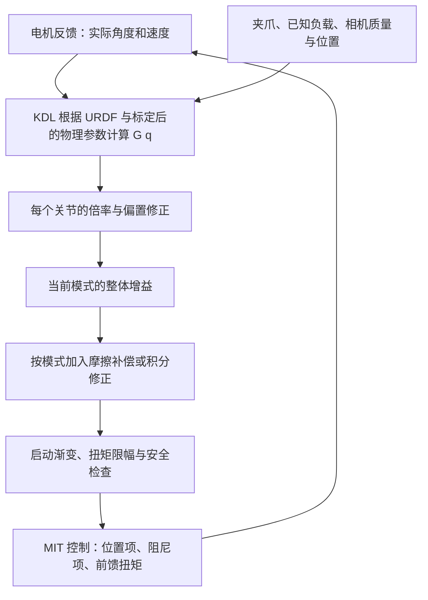

# OpenArm 重力补偿原理与实践教程

本文面向希望理解、使用和排查本项目重力补偿的开发者。内容依据 2026-10-15 的仓库实现；配置数值是当时文件的快照，不代表所有后续运行实例。环境变量、ROS 参数和配置文件路径可能改变实际生效值。

阅读后应能回答三个问题：机械臂为什么能被“托住”？自动微调在调整什么？为什么空载正常，抓重壶后仍可能下垂？

## 1. 从托住一根杆开始理解

把一根有重量的杆水平伸出去，需要用手施加力矩才能保持水平。杆越重、重心离支点越远，需要的力矩越大。对简单情况，可以写成：

\[
\tau = mg\ell\sin\theta
\]

这里的 \(\ell\) 是支点到重心的距离，\(\theta\) 是这条连线与重力方向的夹角，\(\tau\) 的单位是 N·m。

机械臂有多个关节。肩部不仅承受上臂，还承受前臂、腕部、夹爪和负载；各部分对各关节的力矩会随姿态变化。因此，不能用一组固定扭矩补偿所有姿态。

**本项目的做法是：读取实际关节角度，计算当前姿态所需的重力支撑扭矩，再主动下发给电机。**

这叫重力前馈。它根据模型预测支撑需求，而位置反馈是在产生位置误差后再纠正，两者可以同时工作。

## 2. 项目中的完整链路

图中的具体附加项因控制模式不同而变化。例如，Quest 遥操与回放有重力启动渐变，但没有使用零重力模式中的摩擦前馈项。

## 3. 第一步：建立物理模型并计算 G(q)

### 3.1 URDF 提供哪些信息

[assets/v1.urdf](../assets/v1.urdf) 提供连杆质量、质心位置、关节轴和连杆之间的几何关系。程序把 URDF 转换为 KDL 运动链，使用 `KDL::ChainDynParam::JntToGravity` 计算重力项。

\[
G(q)=[G_1(q),G_2(q),\ldots,G_7(q)]
\]

\(q\) 是当前反馈的七个关节角度；\(G_i(q)\) 表示该姿态下第 i 个关节需要提供的模型重力支撑扭矩。角度和速度分别使用 rad、rad/s。

计算依据实际姿态，因此跟踪落后或手动推动后，模型会按新的实际角度更新。不是只按目标姿态计算。

### 3.2 修正连杆质量和质心

项目允许分别调整左右臂：

| 参数 | 含义 |
| --- | --- |
| `left_link_mass_scale`、`right_link_mass_scale` | link1～link7 的质量倍率 |
| `left_link_com_delta`、`right_link_com_delta` | 各连杆质心的 xyz 偏移，单位 m，共 21 个值 |
| `urdf_gravity_scale` | KDL 连杆重力项的整体倍率 |

质量倍率改变重量，质心偏移改变力臂。程序先修改模型再建立动力学求解器，所以这些修正会影响不同姿态下的扭矩分布。

重力项只依赖质量和质心等静态参数。虽然代码也会同比例缩放惯性张量，但静态重力补偿并不依靠转动惯量来产生支撑。

### 3.3 夹爪、负载和相机怎样计入

夹爪手指、夹爪电机和已知负载被近似合并为一个末端点质量。主要控制路径将它放在 link7 局部坐标的 `(0, 0, 0.1475)` m 处。腕部相机则使用独立的质量与偏心位置。

程序根据质量相对关节轴的位置，计算额外重力力矩并投影到关节轴上。因此，相机即使很轻，安装在腕部侧面也可能明显影响 J5～J7。

**当前 `ee_payload_kg` 只描述负载重量，没有独立的负载质心配置。** 长壶、侧向夹持或装水后重心改变，不能完全用“增加几百克”准确表示。当前负载质量字段也是左右臂共用的，不是分别配置两只手中的物体。

## 4. 第二步：修正模型残差

物理模型算出的扭矩仍会有误差。项目对每个关节做倍率与偏置修正：

\[
\tau_{g,i}=\alpha\bigl(s_iG_i(q)+b_i\bigr)
\]

| 符号 | 配置或含义 |
| --- | --- |
| \(s_i\) | `left/right_gravity_scale`：该关节的无量纲倍率 |
| \(b_i\) | `left/right_gravity_bias`：该关节的固定偏置，单位 N·m |
| \(\alpha\) | 当前模式的整体前馈倍率 |

倍率修正“模型整体偏大或偏小”，偏置修正近似固定的剩余扭矩。它们不能完全替代质量与质心模型：如果误差随姿态变化复杂，只调倍率和偏置可能在某些姿态改善、另一些姿态变差。

零重力和 MoveIt 实机使用 `g_scale` / `ff_gain`，使重力项与已验证的零重力标定一致；Quest 位置跟踪仍使用 `tracking_g_scale` / `moveit_g_scale`。两组别名建议分别保持一致。

不要只看整体倍率。例如，当前一些关节的 \(\alpha=0.95\)、\(s_i\approx1.052632\)，两者乘积约为 1。写着 0.95 并不意味着该关节最终只补偿模型的 95%。

## 5. 第三步：按模式加入摩擦补偿

零重力和 MoveIt 路径使用以下摩擦前馈：

\[
\tau_{f,i}=F_{c,i}\tanh(k_i\dot q_i)+F_{v,i}\dot q_i
\]

- `friction_fc`：库仑摩擦近似项，单位 N·m。
- `friction_fv`：随速度变化的黏性摩擦系数。
- `friction_k`：控制零速附近换向过渡的陡峭程度。

这部分前馈帮助电机克服运动阻力；实际抑制晃动的阻尼项来自 MIT 的 Kd，两者作用不同。

在速度为零时，上式为零。真实静摩擦却可能仍然存在，所以它不能保证关节在静止附近完全没有“黏住”和回位死区。

**Quest 遥操和数据回放共用的 `apply_follower_gravity` 路径，只加入重力倍率与偏置修正，没有叠加上述摩擦前馈。** 不能把零重力模式的完整公式直接当作所有模式的实际下发公式。

## 6. 第四步：通过 MIT 模式发给电机

MIT 控制可以概括为：

\[
\tau_{\mathrm{输出}}=
K_p(q_d-q)+K_d(\dot q_d-\dot q)+\tau_{\mathrm{ff}}
\]

这里的 \(\tau_{\mathrm{ff}}\) 是软件下发的前馈扭矩，最终还受电机自身限制与控制实现影响。

| 部分 | 主要职责 | 直观效果 |
| --- | --- | --- |
| Kp 位置项 | 根据位置误差产生回位力矩 | 越大越硬，偏离目标越难 |
| Kd 速度项 | 根据速度误差产生作用 | 抑制晃动、改善动态响应 |
| 重力前馈 | 主动提供模型预测的支撑 | 减少因自重产生的下垂 |
| 摩擦前馈 | 补偿一部分运动阻力 | 减轻拖动阻力，效果取决于模型 |
| MoveIt 积分项 | 按档位补偿剩余静差 | 可能减小保持误差，但会影响柔顺手感 |

假设某姿态需要 1 N·m 支撑，而前馈少了 0.2 N·m，忽略其他因素时，位置闭环必须通过 \(K_p\Delta q=0.2\) 来补足。Kp 为 10 N·m/rad 时，需要约 0.02 rad，也就是 1.15° 的误差。

这个例子说明：提高刚度可以减小下垂，但模型准确时，较低刚度也能提供较好的重力支撑。

## 7. 不同模式的实际区别

| 模式 | 位置保持 | 前馈及附加项 | 使用感受 |
| --- | --- | --- | --- |
| 零重力 | 机械臂 Kp=0 | 重力、摩擦；J5～J7 保留少量 Kd | 可以手拖，松手不会主动回到原目标；残差仍可能造成漂移 |
| Quest 实机遥操 | 跟随遥操目标 | 重力前馈、启动渐变与限幅 | 位置控制跟手，前馈减轻重力负担 |
| 实机数据回放 | 跟随录制参考 | 与 Quest 共用 follower 控制及重力前馈路径 | 重新按当前实际姿态计算支撑，不是原样播放录制扭矩 |
| MoveIt 实机 | 跟随规划轨迹或保持 | 重力、摩擦、按阻抗档位控制的积分项 | 刚度和静态保持效果受档位影响 |

Quest / 回放的重力启动渐变默认约 1 秒；同一控制会话中，松开遥操握持或 Quest 信号丢失不会重新把重力支撑从零开始爬升。

MoveIt 的积分策略包括 `legacy`、`gated`、`frozen`、`off`。当前 P3 和手拖档关闭积分，因此柔顺性提高时，也更容易显露重力模型与静摩擦残差。P2/P3 的 J6 另有受限的非线性位置弹簧和额外阻尼；该弹簧只随位置误差变化，不随时间积累，零误差时额外力矩为零。新轨迹会同时清空普通和冻结积分。

### 当前实现中需要留意的一处差异

零重力、Quest / 回放和 MoveIt 重力模型均使用安装状态辅助函数，按 `*_gripper_present`、`*_wrist_camera_present` 决定是否计入附件。MoveIt 已修正此前忽略安装标记的行为，并保留配置中显式设为零的摩擦参数。

配置中的“右相机不存在”现在也会排除 MoveIt 的右相机重力项。安装标记在此控制质量模型，MoveIt 的电机注册仍保持原有双夹爪要求。跨模式比较手感时，应核对运行进程是否已加载当前配置。

## 8. 为什么需要扭矩限幅

计算出的前馈在下发前会被限制。当前代码中的前馈限幅为：

| 路径 | J1～J7 前馈限幅，单位 N·m |
| --- | --- |
| 零重力、Quest / 回放共享限幅 | `[20, 20, 7, 7, 2, 2, 2]` |
| MoveIt | `[25, 25, 20, 20, 5, 5, 5]` |

**这是前馈分量的限幅，不等于全部电机输出的上限。** MIT 的位置、速度反馈项也会产生扭矩，电机还有自己的能力边界。

MoveIt 另外根据位置项、阻尼项与前馈的保守估计值，在接近电机 tMax 的 80% 时缩小前馈。这是软件保护估计，没有把所有动态项精确合并成一个完整输出扭矩限幅。

如果模型请求的支撑已经超过允许前馈，最终发出的前馈会小于模型所需值。增大模型倍率不一定继续改善，增大 Kp 也不能突破电机真实的输出能力。

## 9. 当前配置快照怎样解读

以 [config/gravity_comp.yaml](../config/gravity_comp.yaml) 在本文编写时的内容为例：

| 字段 | 数值 | 含义 |
| --- | --- | --- |
| `ee_payload_kg` | 0.131 | 模型中的额外负载，不是运行时自动称重结果 |
| `gripper_motor_kg` | 0.300 | 夹爪电机质量；手指质量另外加入 |
| `wrist_camera_kg` | 0.120 | 相机及支架的模型质量 |
| 左 / 右相机安装标记 | true / false | 配置中的安装状态；各模式的重力模型均读取 |
| `g_scale`、`ff_gain` | 0.95 | 零重力及 MoveIt 实机的整体补偿倍率 |
| `tracking_g_scale`、`moveit_g_scale` | 1.00 | Quest 位置跟踪整体补偿倍率 |
| `distal_ee_gain`、`distal_cam_gain` | 各关节均为 1 | 末端点质量附加力矩不再逐关节折减 |

这些值还要与左右臂各自的质量、质心、关节倍率和偏置一起理解。配置存在于文件中，也不意味着某个已经运行的进程已加载最新版；是否支持热更新应按具体模式核对。

## 10. 三个标定按钮分别在做什么

| 操作 | 是否动臂 | 主要作用 |
| --- | --- | --- |
| 使用 URDF 初值 | 否 | 恢复物理模型修正与关节修正的基准，保留安装状态、负载等指定设置 |
| 自动微调 | 是 | 在已有模型上调整每个关节的倍率与偏置 |
| 惯量标定 | 否，使用已有日志 | 辨识质量倍率与质心修正；静态数据不能完整辨识所有转动惯量参数 |

### 自动微调为何从两个方向接近

同一目标姿态，从正、反方向接近，停下来的位置可能不同。这与摩擦、回差等因素有关。如果只采一个方向，容易把摩擦造成的误差也算进重力模型。

当前默认流程是：

1. 分阶段采集腕、肘、肩姿态，从 +δ 和 −δ 两侧接近目标。
2. 等待停稳，在低刚度软持状态采数；移动段不用于默认静态拟合。
3. 用现有重力前馈与软持 PD 残差估计支撑需求，对两侧数据配对处理。
4. 小幅拟合关节倍率、偏置；将完整姿态留出作验证，而不是随机拆散同一姿态的采样点。
5. 验证改善才接受更新；缺失完整阶段、模型与日志不一致等情况拒绝覆盖。

默认自动微调保留质量、质心、负载、摩擦与整体前馈增益。它不是在线不断改变控制参数的自适应算法，而是“采数 → 离线拟合 → 验证 → 写配置”。

详细操作见 [自动重力标定流程说明](自动重力标定流程说明.md)。界面操作会覆盖当前配置，需要保存某版参数时应事先自行复制。

## 11. 用现象判断问题在哪一层

| 现象 | 优先核查 | 判断理由 |
| --- | --- | --- |
| 多个姿态都往下沉 | 负载、整体增益、前馈是否启用 | 可能整体支撑不足 |
| 某些姿态下垂、另一些上浮 | 质心、安装位置、关节轴与模型修正 | 可能存在随姿态变化的模型误差 |
| 空载正常，抓壶后下垂 | 壶的总质量、重心、前馈及电机限幅 | 新增负载没有被准确计入 |
| 从上往下和从下往上停的位置不同 | 摩擦、回差、双向采数结果 | 不一定是重力模型本身错误 |
| 高刚度正常，柔顺档下垂 | 模型残差、积分档位、负载近似 | 高刚度可能用位置误差掩盖了不足 |
| 遥操正常、回放不同 | 生效配置、环境变量、实际速度和参考轨迹、限幅 | 当前两者共用 follower 路径，应检查运行条件是否相同 |
| 突然下坠一下 | CAN 反馈、失能、保护日志、参考切换、扭矩连续性 | 仅凭下坠现象不能认定缺少重力补偿 |

排查时应对照“模型请求扭矩”和“最终下发前馈”，同时查看实际角度、目标角度、速度、Kp/Kd、反馈新鲜度和失能原因。只看关节位置或只看整体倍率，无法区分模型不足、限幅和通信中断。

## 12. 学习与体验顺序

先在仿真中理解姿态变化、关节轴与重心的关系，再做实机体验。仿真中表现良好不等于实机模型、负载和电机参数已经准确。

实机验证前确认急停和 CAN 映射，默认左 `can1`、右 `can0`，确保工作区无碰撞和夹点风险。

建议按以下顺序观察，每一步记录模式、配置版本与负载：

1. **空载零重力**：在不同安全姿态轻推末端，观察松手后漂移方向，以及正反向移动的阻力差异。
2. **固定负载比较**：记录已知负载的总质量与抓持方式，比较补偿前后的下垂。移动负载重心也会改变结果。
3. **MoveIt 保持姿态比较**：在已验证档位之间比较同一姿态；区分较低刚度带来的柔顺性与支撑不足造成的下垂。
4. **核对日志**：检查请求扭矩、下发扭矩和反馈，确认是否限幅，再决定是否需要重新标定。

不要为了验证某个猜测直接取消限幅。停止并释放会使电机失能，重力补偿也随之停止；停止前应确保机械臂有支撑。软急停保持使能，但同样依赖控制器、通信和电机正常工作。

## 13. 阅读源码的建议顺序

| 文件 | 建议关注内容 |
| --- | --- |
| [config/gravity_comp.yaml](../config/gravity_comp.yaml) | 当前安装、负载和标定参数 |
| [src/controller/dynamics.cpp](../src/controller/dynamics.cpp) | KDL 重力计算及末端、相机附加力矩 |
| [src/controller/gravity_comp.hpp](../src/controller/gravity_comp.hpp) | 参数读取、倍率偏置、摩擦函数与共享前馈限幅 |
| [control/openarm_zero_g.cpp](../control/openarm_zero_g.cpp) | 零重力模式如何组合扭矩和腕部阻尼 |
| [src/controller/control.cpp](../src/controller/control.cpp) | `apply_follower_gravity` 的渐变、有效性检查和下发 |
| [src/controller/replay_arm.hpp](../src/controller/replay_arm.hpp) | 回放如何复用 Quest 的 follower 控制 |
| [ros2/src/openarm_moveit_config/scripts/real_arm.cpp](../ros2/src/openarm_moveit_config/scripts/real_arm.cpp) | MoveIt 重力、摩擦、积分和前馈约束 |
| [scripts/calibrate_gravity.py](../scripts/calibrate_gravity.py) | 自动微调的采数、拟合、验证和写入流程 |
| [scripts/lib/runtime_gravity_fit.py](../scripts/lib/runtime_gravity_fit.py) | 双向配对、关节倍率偏置拟合及留出姿态验证 |

## 14. 自测问题

- 为什么同样重量的壶，离腕部更远时可能更难抬起？
- 为什么 Kp 越大，下垂越小，却不能据此认定重力模型准确？
- 为什么 `g_scale=0.95` 不一定等于最终只补偿 95%？
- 为什么零重力模式下松手后不会主动回到原来的姿态？
- 为什么记录关节轨迹不能自动保证重负载回放时的力学效果一致？

参考答案分别对应：重心力臂、反馈补偿残差、多个倍率共同作用、Kp 为零，以及回放时负载与控制条件仍需匹配。
